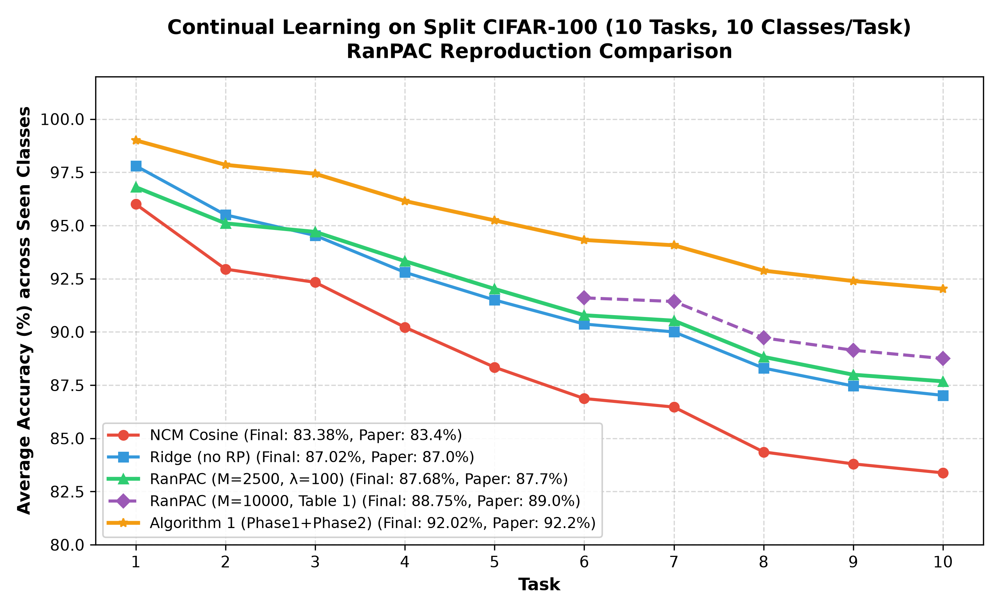
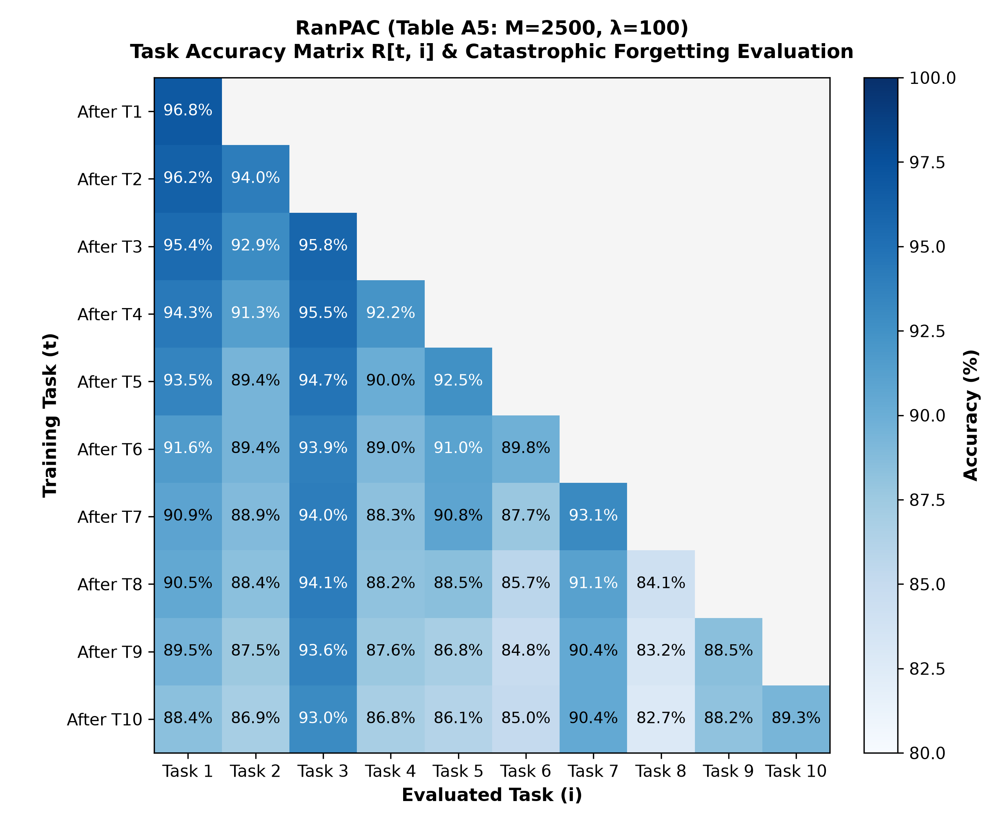

# RanPAC Reproduction

Reproduction of **"RanPAC: Random Projections and Pre-trained Models for Continual Learning"** (NeurIPS 2023, [arXiv:2307.02251](https://arxiv.org/abs/2307.02251)) on Split CIFAR-100, with an extension to ImageNet-R.

## 1. Method in brief

RanPAC performs class-incremental learning on top of a pre-trained ViT-B/16 backbone, with no exemplar replay:

1. **Features**: the (frozen) backbone maps an image to a feature vector `F ∈ R^D`, `D = 768`.
2. **Random projection + ReLU**: `H = ReLU(F · W)`, where `W ∈ R^{D×M}` is a fixed random Gaussian matrix (`M = 2500` or `10000`).
3. **Accumulated ridge regression**: for each task, `G ← G + HᵀH` and `C ← C + HᵀY`; the classifier is the closed-form solution `W_out = (G + λI)⁻¹ C`.

Because only `G` and `C` are accumulated, earlier tasks are never revisited and forgetting stays low. **Algorithm 1** (the full method) adds a Phase 1 in which an AdaptFormer is trained on the first task before the backbone is frozen and Phase 2 above is run.

## 2. Results (Split CIFAR-100, 10 tasks, seed 1993)

Final average accuracy over all seen classes, `A_10`:

| # | Method | Setting | Entry point | Reproduced | Paper | Δ |
|:-:|:--|:--|:--|:-:|:-:|:-:|
| 1 | NCM cosine | Frozen ViT + nearest class mean | `notebooks/01_ncm_cosine.ipynb` | **83.38%** | 83.4% (Table 1) | −0.02 pp |
| 2 | Ridge (no RP) | Frozen ViT + ridge regression | `notebooks/02_ridge_no_rp.ipynb` | **87.02%** | 87.0% (Table 1) | +0.02 pp |
| 3 | RanPAC (Table A5) | `M=2500`, ReLU, fixed `λ=100` | `src/run_local.py` (`rp-table-a5`) | **87.68%** | 87.7% (Table A5) | −0.02 pp |
| 4 | RanPAC (Table 1) | `M=10000`, ReLU, per-task CV of `λ` | `notebooks/03_ridge_rp_relu.ipynb` | **88.75%** | 89.0% (Table 1) | −0.25 pp |
| 5 | Algorithm 1 (full) | AdaptFormer Phase 1 + RanPAC Phase 2 | `notebooks/04_ranpac_full.ipynb` | **92.02%** | 92.2% (Table 1) | −0.18 pp |

Additional experiments: the `M` sweep (`notebooks/05_ranpac_m_sweep.ipynb`) and Algorithm 1 on ImageNet-R (`notebooks/06_ranpac_full_imagenetr.ipynb`, compared against the authors' code in `notebooks/RanPAC_original_ImageNetR.ipynb`).





With the Table A5 configuration, accuracy on Task 1 is 90.4% after learning all 10 tasks (96.8% right after Task 1). The full write-up, including ablations, forgetting metrics and the Phase 1 curve, is in [results/results.md](results/results.md).

## 3. Repository layout

```
src/            Core library and runners
  ranpac_core.py        NCM, ridge, lambda selection, class split
  ranpac_data.py        CIFAR-100 loading and embedding cache
  ranpac_colab.py       Phase 2 runner, W&B logging, checkpoints
  ranpac_full.py        Algorithm 1 (AdaptFormer Phase 1 + Phase 2)
  ranpac_imagenetr.py   ImageNet-R dataset support
  run_local.py          Local (non-Colab) CLI runner
notebooks/      Colab notebooks 01-06 and the original-code ImageNet-R baseline
scripts/        plot_comparison.py, plot_heatmap.py, rank_sweep_g.py
tests/          CPU unit tests for the Phase 2 protocol
results/        results.md, figures and CSV outputs
docs/           SETUP.md (Colab setup guide)
```

## 4. Running

Requires Python 3.9+; a CUDA GPU is needed for feature extraction and Phase 1.

```powershell
pip install torch torchvision --index-url https://download.pytorch.org/whl/cu124
pip install -r requirements.txt
```

**Colab**: follow [docs/SETUP.md](docs/SETUP.md) and run notebooks `01`–`06`.

**Local** (from the repository root):

```powershell
python src/run_local.py --preset rp-table-a5 --wandb_entity <entity> --wandb_project <project> --wandb_mode offline
```

Other presets: `ncm`, `ridge`, `rp-table1`.

**Plots** (read from `ranpac-runs/`, write to `results/`):

```powershell
python scripts/plot_comparison.py
python scripts/plot_heatmap.py
```

**Tests**:

```powershell
python -m unittest discover -s tests
```

## 5. Experiment mapping

All runs are logged to the W&B project [pnp123/ML](https://wandb.ai/pnp123/ML). Every number in the report traces to a row below.

| Experiment | Produced by | W&B | What it shows |
|:--|:--|:-:|:--|
| NCM cosine, `A_10` = 83.38% | `notebooks/01_ncm_cosine.ipynb` | [pnp123/ML](https://wandb.ai/pnp123/ML) | A frozen ViT with class means already reaches the paper's NCM baseline. |
| Ridge without RP, 87.02% | `notebooks/02_ridge_no_rp.ipynb` | [pnp123/ML](https://wandb.ai/pnp123/ML) | Ridge on raw features beats NCM by about 3.6 pp. |
| RanPAC Table A5, 87.68% | `src/run_local.py --preset rp-table-a5` | [pnp123/ML](https://wandb.ai/pnp123/ML) | Random projection with fixed `λ` is enough; also source of the forgetting heatmap. |
| RanPAC Table 1, 88.75% | `notebooks/03_ridge_rp_relu.ipynb` | [pnp123/ML](https://wandb.ai/pnp123/ML) | Larger `M` and per-task `λ` selection add about 1 pp. |
| Algorithm 1, 92.02% | `notebooks/04_ranpac_full.ipynb` | [pnp123/ML](https://wandb.ai/pnp123/ML) | Phase 1 adaptation on task 1 adds about 3 pp over Phase 2 alone. |
| `M` sweep | `notebooks/05_ranpac_m_sweep.ipynb` | [pnp123/ML](https://wandb.ai/pnp123/ML) | Accuracy, time and memory versus projection size `M`. |
| ImageNet-R | `notebooks/06_ranpac_full_imagenetr.ipynb` | [pnp123/ML](https://wandb.ai/pnp123/ML) | Algorithm 1 against the authors' code on a harder benchmark. |

## 6. Reproducibility, dependencies and reuse

- **Seeds**: the class order and all random projections use seed `1993`; per-task `λ` selection uses `1993 + task`; Phase 1 data order uses `1993 + epoch`. Seeds are defined in `src/ranpac_core.py` and stored in each run's `config.json`.
- **Standard stack**: `numpy`, `torch`, `torchvision`, `Pillow`.
- **Extra libraries**: `timm` supplies the pre-trained ViT-B/16 weights and blocks (re-implementing and re-training ImageNet-21K weights is out of scope); `wandb` logs every run to the public project above; `datasets` downloads CIFAR-100 from the Hugging Face Hub.
- **Own implementation**: random projection, accumulated ridge regression, `λ` selection, NCM, the AdaptFormer adapters and the two-phase loop were written from the paper's description. The authors' code was only run to compare outputs (ImageNet-R baseline notebook), never copied.
- **Reused**: ViT backbone and pre-trained weights from `timm`, image transforms from `torchvision`, CIFAR-100 from the Hugging Face Hub.

## 7. Data and backbone

- **Dataset**: CIFAR-100, loaded at run time from the Hugging Face Hub ([`uoft-cs/cifar100`](https://huggingface.co/datasets/uoft-cs/cifar100)) with no manual preparation, and split into 10 tasks with seed `1993`. ImageNet-R (the authors' train/test split, re-hosted for this project) is loaded at run time from [`lmcu000/imagenet-r-split`](https://huggingface.co/datasets/lmcu000/imagenet-r-split) on the Hugging Face Hub; see [docs/SETUP.md](docs/SETUP.md).
- **Backbone**: `vit_base_patch16_224.augreg_in21k`, loaded through `timm`.

## 8. Citation

```bibtex
@inproceedings{mcdonnell2023ranpac,
  title={RanPAC: Random Projections and Pre-trained Models for Continual Learning},
  author={McDonnell, Mark D and Gong, Dong and Parvaneh, Amin and Ehsan, Mohammad Reza and Abbasnejad, Ehsan and van den Hengel, Anton},
  booktitle={Advances in Neural Information Processing Systems (NeurIPS)},
  year={2023}
}
```
