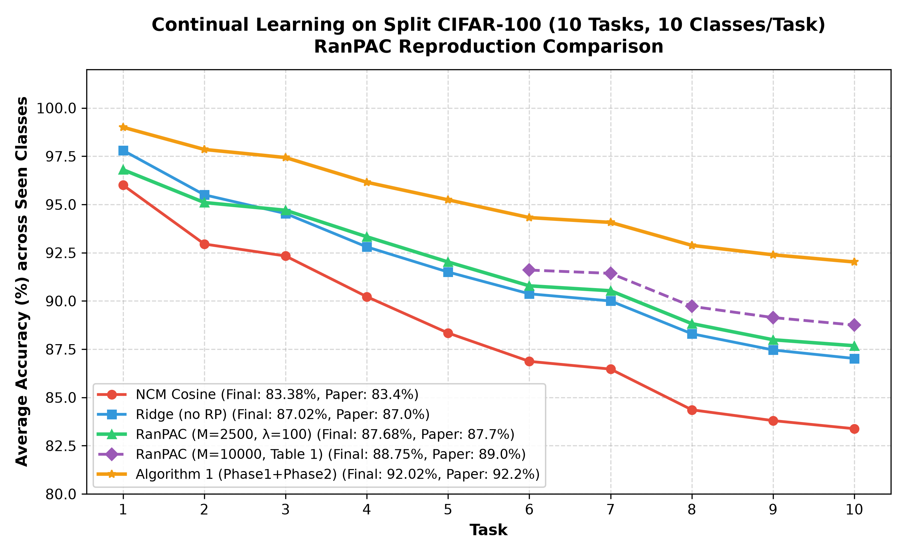
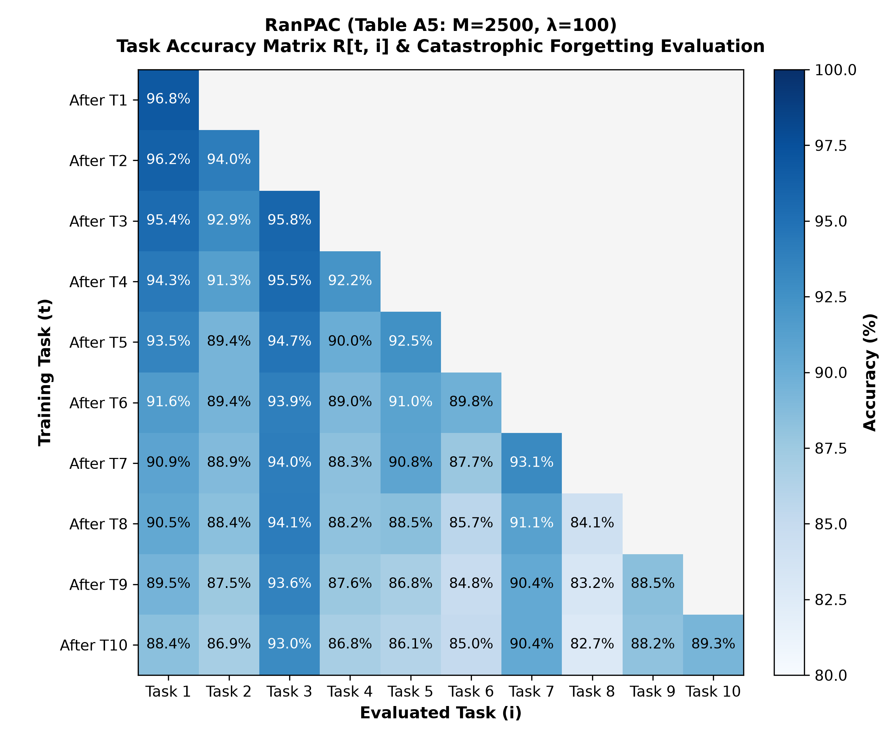

# Experimental Methodology — RanPAC Reproduction

> Paper: McDonnell et al., "RanPAC: Random Projections and Pre-trained Models for Continual Learning," NeurIPS 2023.

---

## 1. Datasets

### 1.1 Benchmark: Split CIFAR-100

All reproduction experiments in this report use **Split CIFAR-100**, a standard class-incremental learning benchmark derived from CIFAR-100 (60,000 images, 100 classes, 32×32 pixels).

| Property | Value |
|---|---|
| Total classes | 100 |
| Number of tasks | 10 |
| Classes per task | 10 (disjoint, in fixed order) |
| Training images per class | 500 |
| Test images per class | 100 |
| Random seed | 1993 |

The 100 classes are split into 10 sequential tasks of 10 classes each. Task identity is **not** provided at test time (class-incremental setting). After task $t$, the model is evaluated on all $10t$ classes seen so far.

### 1.2 Original Paper Benchmarks (for reference)

The paper evaluates on seven CIL and two DIL benchmarks:

| Type | Datasets |
|---|---|
| Class-incremental (CIL) | CIFAR-100, ImageNet-R, ImageNet-A, CUB-200, OmniBenchmark, VTAB, Stanford Cars |
| Domain-incremental (DIL) | CORe50, DomainNet |

---

## 2. Backbone

All experiments use a **ViT-B/16** (Vision Transformer, Base, patch size 16) pre-trained on ImageNet-21K, loaded from the `timm` library. The backbone is **frozen** throughout Phase 2 and produces $L = 768$-dimensional features.

---

## 3. Evaluation Metric

The primary metric is **final average accuracy** (also called $A[T]$ or $A[10]$ in this report):

$$
A[T] = \frac{1}{K} \sum_{k=1}^{K} \text{Acc}_k
$$

where $K$ is the total number of classes seen after all $T$ tasks, and $\text{Acc}_k$ is the accuracy on class $k$ evaluated at the **end of training** (after task $T$).

The paper also reports **per-task accuracy** $A[t]$ after each task $t$, which tracks how performance on all seen classes evolves as new tasks arrive. We additionally compute the **forgetting matrix** $R[t, i]$, defined as the accuracy on task $i$'s classes measured right after task $t$ is learned.

---

## 4. Experimental Protocol

### 4.1 Continual Learning Setting

- **No rehearsal buffer:** samples from earlier tasks are never stored or replayed.
- **No task identity at test time:** the model must predict the class label among all $K$ seen classes without knowing which task the input belongs to.
- **Single pass per task:** training data for each task is processed once; there is no multi-epoch SGD over task data in Phase 2.

### 4.2 Phase Configuration

We reproduce five experimental configurations from the paper:

| Preset | Description | Phase 1 | Classifier |
|---|---|---|---|
| `ncm` | Nearest Class Mean (cosine) | ✗ | Cosine similarity to class mean |
| `ridge` | Ridge regression, no random projection | ✗ | Ridge on raw backbone features |
| `rp-table-a5` | Ridge + RP, M=2500, λ=100 (Table A5) | ✗ | Ridge on expanded features |
| `rp-table1` | Ridge + RP, M=10000, task-CV λ (Table 1) | ✗ | Ridge on expanded features |
| **Algorithm 1** | **AdaptFormer (20 epochs) + Ridge + RP** | ✓ (AdaptFormer) | Ridge on expanded features |

The first four presets form an **ablation study**: each adds one component to the previous, isolating contributions of random projection and second-order statistics. Algorithm 1 is the full method and serves as the ceiling.

### 4.3 Hyperparameters

| Hyperparameter | Value |
|---|---|
| Random projection dimension $M$ | 10,000 |
| Projection activation $\phi$ | ReLU |
| Ridge coefficient $\lambda$ | Selected per task from a fixed candidate set |
| Random seed | 1993 |
| Backbone | ViT-B/16 (frozen, ImageNet-21K pre-trained) |

### 4.4 Training Environment

| Environment | Specification |
|---|---|
| **Local** | NVIDIA RTX 4060 Laptop GPU (8 GB VRAM), CUDA 12.4, Python 3.11 |
| **Cloud** | Google Colab (T4 GPU, 15 GB VRAM) |
| PyTorch | 2.6.0 |
| timm | 1.0.31 |
| wandb | 0.31.0 |

---

## 5. Baselines

The paper compares RanPAC against the following baselines, all without a rehearsal buffer:

| Baseline | Description |
|---|---|
| **L2P** | Learning to Prompt — trains a prompt pool per task via gradient descent |
| **DualPrompt** | Separates task-shared and task-specific prompts |
| **CODA-Prompt** | Attention-weighted prompt composition |
| **SLCA** | Slow learner with classifier alignment; updates the backbone every task |
| **ADaM** | Class prototypes on frozen features; PETL on task 1 |
| **Joint fine-tuning** | Upper bound: full fine-tuning on all tasks simultaneously |

In this reproduction, the four presets (`ncm`, `ridge`, `rp-table1`, `rp-table-a5`) represent **ablation points** of the full RanPAC method, allowing us to isolate the contributions of random projection, ridge regression, and the second-order statistics.

---

## 6. Results

### 6.1 Reproduced vs. Paper Results

| Preset | $A[10]$ reproduced | $A[10]$ paper | Δ |
|---|---|---|---|
| `ncm` | 83.38% | 83.4% | −0.02 pp |
| `ridge` | 87.02% | 87.0% | +0.02 pp |
| `rp-table-a5` | 87.68% | 87.7% | −0.02 pp |
| `rp-table1` | 88.75% | 89.0% | −0.25 pp |
| **Algorithm 1** | **92.02%** | **92.2%** | **−0.18 pp** |

All reproduced results are within **0.25 percentage points** of the reported values.

### 6.2 Per-task Accuracy Curves

### 6.3 Forgetting Heatmap (`rp-table-a5`)

The heatmap below shows $R[t, i]$ — accuracy on the classes of task $i$ measured after training on task $t$. Each row is a snapshot after one task; each column tracks one task's accuracy over time.

---

## 7. Experiment Tracking

All runs are logged to the shared W&B project **`pnp123/ML`** on Forge CoreWeave:

- **Colab runs** (`ncm`, `ridge`, `rp-table1`): logged online during training.
- **Local run** (`rp-table-a5`): logged offline and synced post-training via `wandb sync`.

Run IDs, per-task metrics, and accuracy matrices are stored under `ranpac-runs/runs/`.
