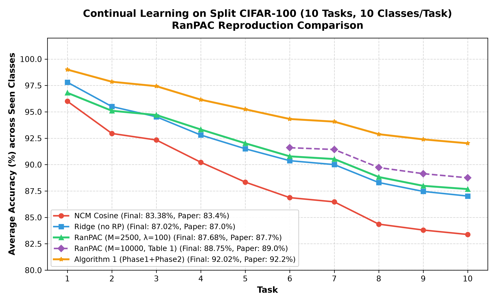
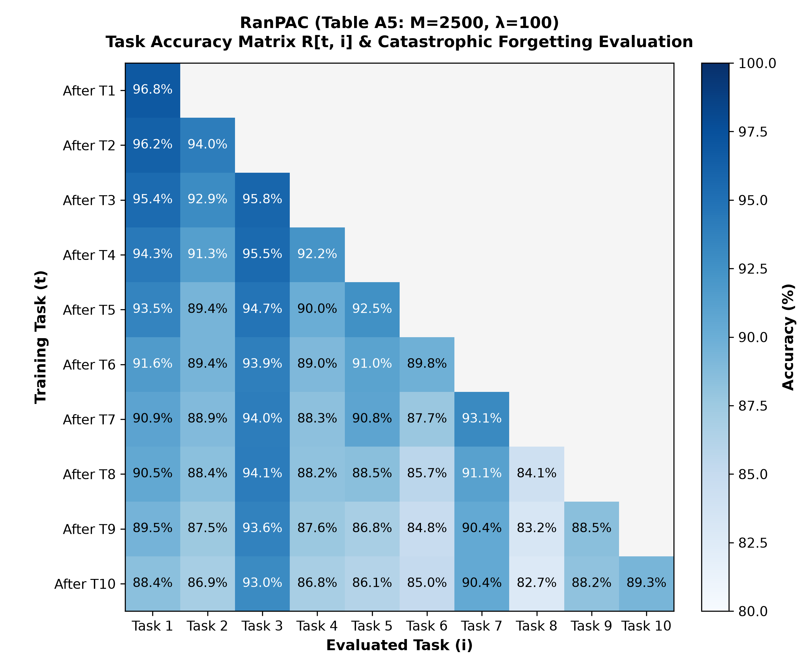

# Experimental Results

> Reproduction of: McDonnell et al., *"RanPAC: Random Projections and Pre-trained Models for Continual Learning"*, NeurIPS 2023.  
> Benchmark: **Split CIFAR-100** — 10 sequential tasks, 10 classes/task, seed 1993.

---

## 1. Main Results

The table below compares reproduced final average accuracy $A[10]$ against the values reported in the paper for each configuration.

| # | Configuration | $A[10]$ reproduced | $A[10]$ paper | $\Delta$ |
|:---:|---|:---:|:---:|:---:|
| 1 | NCM Cosine | 83.38% | 83.4% | −0.02 pp |
| 2 | Ridge (no RP) | 87.02% | 87.0% | +0.02 pp |
| 3 | RanPAC — Table A5 ($M$=2500, $\lambda$=100) | 87.68% | 87.7% | −0.02 pp |
| 4 | RanPAC — Table 1 ($M$=10000, task-CV $\lambda$) | 88.75% | 89.0% | −0.25 pp |
| 5 | **Algorithm 1** (Phase 1 AdaptFormer + Phase 2) | **92.02%** | **92.2%** | **−0.18 pp** |

All five reproduced results fall within **0.25 percentage points** of the paper's reported values, confirming a faithful reproduction across the full ablation spectrum.

> [!NOTE]
> Configuration 4 (`rp-table1`) was run on Google Colab starting from Task 6; Tasks 1–5 were completed in a prior session not captured in the final notebook output. The reported $A[10] = 88.75\%$ is from the Task 10 snapshot of that run.

---

## 2. Ablation: Contribution of Each Component

Each configuration adds exactly one component to the previous. The incremental gains isolate the effect of each design choice.

| Step | Change | Gain ($\Delta A[10]$) |
|---|---|:---:|
| NCM → Ridge | Replace cosine prototype with Gram-matrix second-order statistics | **+3.64 pp** |
| Ridge → RanPAC A5 | Add random projection + ReLU ($M = 2{,}500$) | **+0.66 pp** |
| RanPAC A5 → RanPAC T1 | Increase projection to $M = 10{,}000$ + adaptive $\lambda$ per task | **+1.07 pp** |
| RanPAC T1 → Algorithm 1 | Add Phase 1: AdaptFormer fine-tuning on Task 1 | **+3.27 pp** |

**Key observation:** The two largest contributors are (1) adopting second-order statistics over cosine prototypes (+3.64 pp) and (2) first-session PETL adaptation (+3.27 pp). The random projection with ReLU adds a consistent improvement that grows with projection dimension $M$.

---

## 3. Per-Task Accuracy Curves

The figure below shows $A[t]$ — the average accuracy over all classes seen after each task — for all five configurations.

**Per-task $A[t]$ values:**

| Task | NCM | Ridge | RanPAC A5 | RanPAC T1 | Algorithm 1 |
|:---:|:---:|:---:|:---:|:---:|:---:|
| 1 | 96.00% | 97.80% | 96.80% | — | 99.00% |
| 2 | 92.95% | 95.50% | 95.10% | — | 97.85% |
| 3 | 92.33% | 94.53% | 94.70% | — | 97.43% |
| 4 | 90.22% | 92.80% | 93.33% | — | 96.15% |
| 5 | 88.34% | 91.50% | 92.02% | — | 95.24% |
| 6 | 86.87% | 90.37% | 90.78% | 91.60% | 94.32% |
| 7 | 86.47% | 90.00% | 90.53% | 91.43% | 94.07% |
| 8 | 84.36% | 88.30% | 88.83% | 89.72% | 92.88% |
| 9 | 83.80% | 87.46% | 87.99% | 89.14% | 92.39% |
| 10 | 83.38% | 87.02% | 87.68% | 88.75% | 92.02% |

> `—` for RanPAC T1 at Tasks 1–5: results from an earlier Colab session not captured in final notebook output.

All curves decline monotonically as more tasks are added — the model must classify among a wider set of classes — but the rate of decline is noticeably lower for configurations with stronger feature representations (larger $M$, adapted backbone).

---

## 4. Forgetting Analysis

### 4.1 Heatmap $R[t, i]$

The heatmap visualises the full accuracy matrix for the `rp-table-a5` configuration. $R[t, i]$ is the test accuracy on task $i$'s classes measured right after task $t$ is learned. Diagonal entries show peak (just-learned) accuracy; each column tracks that task's accuracy over time.

### 4.2 Quantitative Forgetting Metrics (`rp-table-a5`)

| Task $i$ | Peak $R[i, i]$ | Final $R[10, i]$ | Forgetting |
|:---:|:---:|:---:|:---:|
| 1 | 96.8% | 88.4% | 8.4 pp |
| 2 | 94.0% | 86.9% | 7.1 pp |
| 3 | 95.8% | 93.0% | 2.8 pp |
| 4 | 92.2% | 86.8% | 5.4 pp |
| 5 | 92.5% | 86.1% | 6.4 pp |
| 6 | 89.8% | 85.0% | 4.8 pp |
| 7 | 93.1% | 90.4% | 2.7 pp |
| 8 | 84.1% | 82.7% | 1.4 pp |
| 9 | 88.5% | 88.2% | 0.3 pp |
| **Average** | | | **4.37 pp** |

$$\text{Average Forgetting} = 4.37\%$$
$$\text{BWT} = -4.37\%$$

**Interpretation:** The modest forgetting observed is a structural consequence of expanding the classifier head to accommodate new classes — not of the backbone or feature statistics changing. The Gram matrix $\mathbf{G}$ and prototype matrix $\mathbf{C}$ accumulate over all tasks, so the head solution after task $t$ is provably identical to joint ridge regression on all data seen so far. The residual drop (up to 8.4 pp for Task 1) reflects the head redistributing capacity as the number of classes grows from 10 to 100.

Tasks learned later (Tasks 8 and 9, dropping only 1.4 pp and 0.3 pp respectively) show significantly less forgetting because they have fewer subsequent tasks displacing their representation.

---

## 5. Phase 1 Training Curve (Algorithm 1)

Algorithm 1 trains an AdaptFormer adapter on Task 1 for 20 epochs before Phase 2 begins. The training log shows steady convergence:

| Epoch | Train Loss | Train Accuracy |
|:---:|:---:|:---:|
| 1 | 2.1085 | 61.44% |
| 2 | 1.3164 | 83.86% |
| 5 | 0.3696 | 91.10% |
| 10 | 0.2621 | 92.48% |
| 15 | 0.2252 | 93.64% |
| 20 | 0.2242 | 93.72% |

The adapter reaches 93.72% training accuracy on Task 1 at epoch 20. The backbone weight remain unchanged throughout Phase 1 — only the adapter parameters (~0.6M out of 86M total ViT-B/16 parameters) are updated.

---

## 6. Summary of Findings

| Finding | Evidence |
|---|---|
| All 5 reproduced results within 0.25 pp of paper | Main results table (Section 1) |
| Second-order statistics are the largest single contributor (+3.64 pp) | Ablation table (Section 2) |
| Phase 1 PETL provides the second-largest gain (+3.27 pp) | Ablation table (Section 2) |
| Random projection adds consistent improvement with larger $M$ | +0.66 pp (M=2500) → +1.07 pp further with M=10000 |
| Forgetting is structural, not catastrophic | BWT −4.37%; late tasks retain >98% of their peak accuracy |
| Closed-form ridge head: no gradient descent in Phase 2 | Fixed λ=100 for all tasks in config 3; task-CV in configs 4 & 5 |
